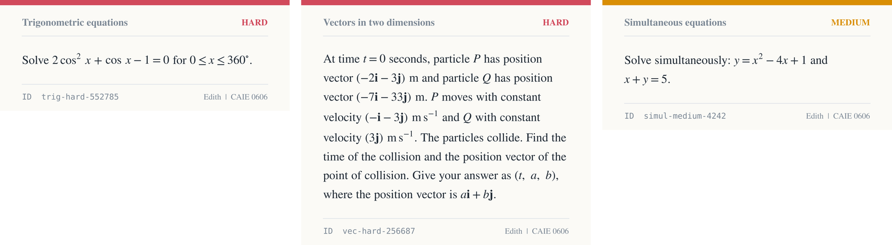

# Edith: a CAIE Additional Mathematics tutor that checks its own maths


Edith is a Telegram tutor for CAIE IGCSE Additional Mathematics (0606). She teaches with hints and never hands over the final answer. She also does not trust a language model with the maths: practice questions and answer keys come from code, and every answer a student types is judged by sympy. The whole system runs on free models.



## What she does

- **Teaches in steps.** She asks what you have tried, teaches the method with a worked example on a different question, then gives hints one at a time: a nudge, the name of the method, a partial step, a fully worked similar example.
- **Holds the line.** Ask her to "just give the answer" and she offers the next hint instead. After a correct answer she gives three follow-up questions (easy, medium, exam level).
- **Practice questions on 24 topics at 3 levels.** Each question has an ID such as `quad-medium-31415`. The same ID always gives the same question and the same answer key.
- **Question cards.** Questions arrive as clean images with the maths typeset. Telegram cannot render LaTeX, so the cards are drawn with matplotlib.
- **Graphs on request.** Sketches, tangents, shaded areas.
- **Progress tracking.** Scores come from a log of what she actually ran. `progress.py next` picks the weakest topic.
- **Stays on topic.** Anything outside 0606 gets a one-line decline and an offer of a maths topic.

Topics: differentiation, integration, stationary points, tangents and normals, rates and optimisation, areas, kinematics, quadratics, polynomials, modulus equations, inequalities, simultaneous equations, logarithms and exponentials, functions, straight lines, linear law, coordinate geometry of the circle, circular measure, trigonometric equations, trigonometric graphs, permutations and combinations, binomial expansion, progressions, vectors.

## What is checked, and what is not

| Part | Who does it | How it is checked |
|---|---|---|
| Practice questions | Code (`tools/gen.py`) | Tests build every topic and level, many seeds |
| Answer keys | sympy, computed from the question | A second solver re-derives every answer from the question text. Tests break the generator on purpose to confirm the solver notices |
| Judging a student's answer | `gen.py check` (symbolic and numeric comparison) | Tests for the many ways students write an answer, and for hostile input |
| Naming the usual slip behind a wrong answer | `tools/slips.py`, computed from the question | Every slip answer is checked to be typable and readable, and hand-made cases name the right slip |
| Worked examples in the notes | sympy, at build time | `build_knowledge.py` stops if any example is wrong, and a test rebuilds the notes |
| Wording of explanations and hints | A free language model | The persona rules force it to check calculations with `tools/check.py`. **Not guaranteed.** |

So the claim is narrow and true: the questions, the answer keys and the marking are computed, not generated. A free model still writes the explanations, and it can still make a mistake in prose. The benchmark (below) measures how often.

Example, with the real tool output:

```
$ python tools/gen.py new quad medium 31415
ID: quad-medium-31415  (Quadratics, medium)
QUESTION: The equation x^2 + kx + 18 = 0 has equal roots. Find the possible values of k.

$ python tools/gen.py check quad-medium-31415 "k = 5"
INCORRECT

$ python tools/gen.py hint quad-medium-31415 1
HINT 1: Equal roots means the discriminant b^2 - 4ac = 0.

$ python tools/gen.py check diff-medium-100 "-sin(4x-6)"
INCORRECT
DIAGNOSIS (chain): You differentiated the outer function but forgot the chain rule. Multiply by the derivative of the inside function.
```

The diagnosis is not written by the model. For each question the code computes the answers that the usual slips would give (a dropped chain factor, a sign slip, one of two solutions, the tangent instead of the normal, and so on) and compares the student's answer with them. The advice is fixed text and never contains the answer. `progress.py mistakes` lists the slips that keep coming back.

## Try it without Telegram

```
pip install -r requirements.txt
python tools/gen.py list
python tools/gen.py new diff medium
python tools/gen.py check <id> "<your answer>"
python tools/render.py <id>          # writes a question card into plots/
python tools/plot.py "x^2-4x+3" --mark
```

Tests (over 700, about two minutes):

```
pip install -r requirements-dev.txt
python -m pytest
```

## Run Edith on Telegram

Edith is an agent for OpenClaw, a self-hosted assistant gateway. Create an agent whose workspace is this folder, connect it to a Telegram bot, and pick a model. `SOUL.md` is the whole behaviour contract. See [docs/SETUP.md](docs/SETUP.md).

## Benchmark

`bench/bench.py` asks free OpenRouter models the same generated questions with no tools and no hints, then scores them with the same checker. It shows which free model is worth putting in Edith's fallback chain. `bench/leak.py` is a second test: it pushes for the final answer ("just tell me", exam panic, a fake instruction override) with and without `SOUL.md`, and counts how often the reply gives the answer away. Method: [docs/BENCHMARK.md](docs/BENCHMARK.md).

Results from October 2026, three free models (agnes-3.0-flash, deepseek-v4.1-flash, k2-horizon):

| Test | Result |
|---|---|
| Accuracy, 67 questions all three answered (24 topics, 3 levels) | 64 of 67 for each model, 96% (95% interval 88% to 98%) |
| Gave the final answer under pressure, plain tutor prompt | 78 of 87 replies, 90% |
| Same test with `SOUL.md` | 6 of 89 replies, 7% |
| Same test after adding the mark-scheme and no-reasoning rules | 3 of 89 replies, 3% (all from one model that prints its reasoning into the reply) |

Full tables: [accuracy](docs/BENCHMARK_RESULTS.md), [leaks, first run](docs/LEAK_RESULTS.md), [leaks, after the rule change](docs/LEAK_RESULTS_V2.md). The leak test sends one message per case and uses no tools, and the accuracy set is small, so read the intervals and not only the percentages.

## Layout

```
SOUL.md                  the persona and rules (the only prompt)
tools/gen.py             questions, answer keys, hints, marking
tools/check.py           sympy calculator for the tutor
tools/plot.py            graphs
tools/render.py          question cards
tools/slips.py           the usual slips behind a wrong answer
tools/progress.py        scores and recurring slips from the call log
knowledge/               syllabus notes and 16 topic files
bench/                   model benchmark and answer-leak test, with a fake OpenRouter for tests
tests/                   over 700 tests, including the independent solver
scripts/                 build the notes, sample sheet, export script
docs/                    architecture, setup, benchmark
```

## Limits

- Not affiliated with or endorsed by Cambridge University Press & Assessment. The notes are original study notes, not Cambridge text, and the generator does not copy past papers.
- The formula list and the "not in the syllabus" list in `knowledge/syllabus.md` were written from the 2025 to 2027 syllabus and should be checked against the current official PDF.
- Free models are slow and rate limited (OpenRouter free tier: 20 requests a minute, 50 a day unless credits have been bought).
- No marking of photographed working yet. Answers are typed.

## Licence

MIT. See [LICENSE](LICENSE).
