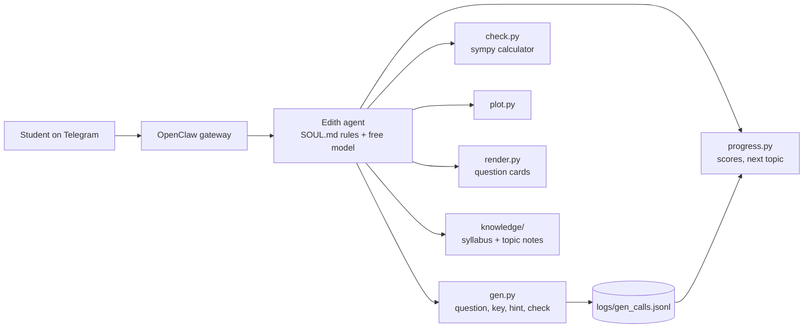

# Architecture

## The rule everything follows

The language model never makes up a question and never judges an answer. It decides what to say next. Code does the maths.

## Parts

**Generator (`tools/gen.py`).** Each topic has a function that takes a seeded random generator and a level and returns the question text, an answer, a list of hints and an answer kind (expression, set, pairs, interval, vector, equation and so on). The ID `topic-level-seed` rebuilds exactly the same question, so the chat history carries all the state Edith needs. The answer is computed with sympy, so it is correct by construction.

**Marking.** The student's text is cleaned, then parsed by a restricted parser. The parser allows only plain maths characters, rejects attribute access and long words, and walks the syntax tree to reject huge powers such as `9^9^9^9`. Then each answer kind has its own comparison: derivatives and integrals by differentiating back, inequalities by testing boundaries and points between them, vectors in several notations, implicit equations up to a constant factor. The verdicts are CORRECT, INCORRECT, AMBIGUOUS (`a/2x` can be read two ways), NOT EXACT (a decimal where an exact answer is asked) and COULD NOT READ THE ANSWER.

**Hints.** Hints are written with each question, in order, and released one at a time. `reveal` is allowed only after a correct answer or after the hints run out.

**Progress (`tools/progress.py`).** There is no database. Every `gen.py` call is appended to `logs/gen_calls.jsonl`, and the scores are computed from that log: a clean first try, help needed, revealed or abandoned. New topics appear automatically.

**Question cards (`tools/render.py`).** A small parser turns the plain-text question into matplotlib mathtext and lays words and maths out on a card. It reads the question only. It never sees the answer.

**Knowledge (`knowledge/`).** The syllabus scope plus 16 topic files, each with methods, common traps, worked examples checked with sympy, and a teaching order. `scripts/build_knowledge.py` regenerates them and fails if a worked example is wrong.

## How it is tested

- `tests/test_generator.py`: every topic and level builds, repeats, accepts its own answer and rejects wrong ones.
- `tests/independent/`: a separate solver re-derives each answer from the question text. A planted bug in the generator makes it fail.
- `tests/test_answer_formats.py`, `tests/test_security.py`: the many ways to write an answer, and hostile input.
- `tests/test_bench.py`: the benchmark against a fake OpenRouter.
- `tests/test_persona.py`: `SOUL.md` still contains the rules the project promises.
- `tests/test_repo_hygiene.py`: no keys, tokens or personal details in the repository.
